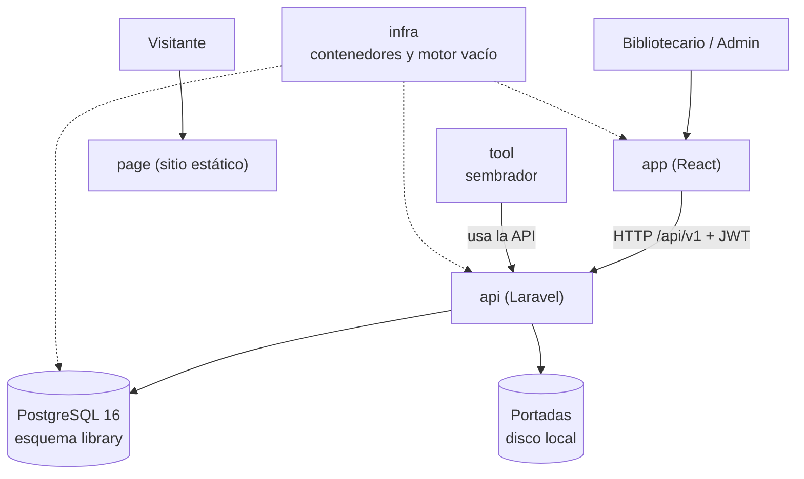
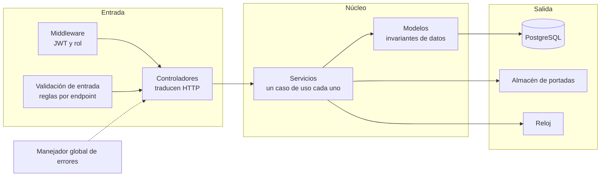
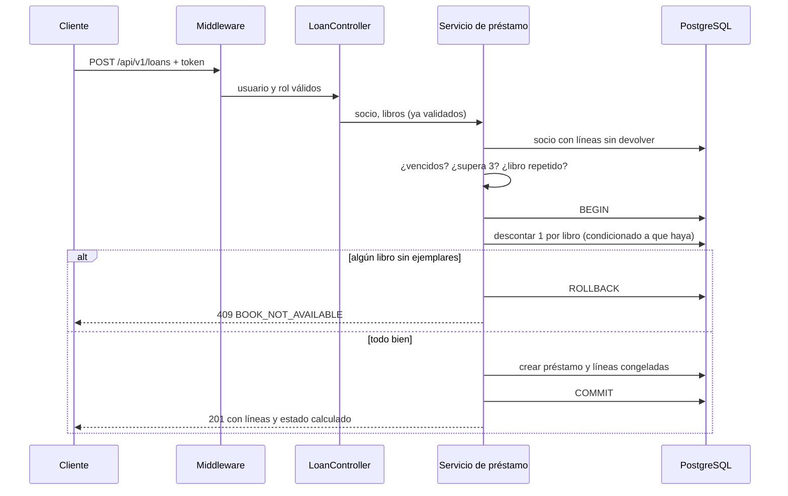
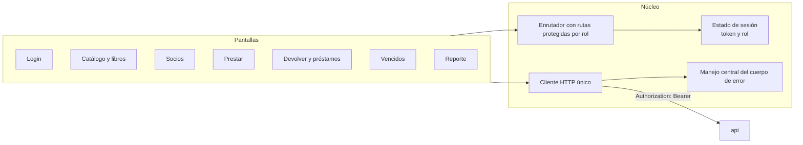

# Arquitectura — Manager Library (Laravel + React)

Adaptación de [`architecture.md` del spec .NET](https://github.com/code-sena/test-manager-library-3239188-docs) al stack del reto. El spec usa arquitectura hexagonal estricta; aquí se aplica una versión en capas simples, por las razones del [ADR-007](adr/adr-007-arquitectura-en-capas-simples.md). El negocio, el contrato y el modelo de datos no cambian.

> Documento de diseño. La implementación está pendiente; el estado real está en [`SPEC-NOTES.md`](SPEC-NOTES.md) y [`tasks.md`](tasks.md).

## 1. Vista general



`page` no llama a la API. `tool` nunca escribe en la base directamente.

## 2. Backend: capas y dependencias



Reglas de dependencia (versión simplificada de los artículos I a III):

| Regla | Qué significa |
|---|---|
| Los controladores no contienen reglas de negocio | Solo reciben la petición ya validada, llaman a un servicio y devuelven la respuesta |
| Un servicio por caso de uso | `LendBooks`, `ReturnItem`, `CreateBook`, `SearchBooks`, `Overdue`, `MostBorrowedReport`, `Login`, `CreateLibrarian`, etc. |
| Los modelos defienden sus invariantes | Disponibles entre 0 y total, estado del préstamo calculado, vencimiento a 14 días |
| Solo el manejador global arma el cuerpo de error | Un error de framework nunca llega al cliente |
| El reloj es inyectable | Permite probar vencimientos sin esperar 14 días |

No hay interfaces para cada repositorio ni pruebas automáticas de arquitectura (T-19, fuera de alcance por el ADR-007).

## 3. Estructura de carpetas prevista (backend)

```text
api/
├── app/
│   ├── Http/
│   │   ├── Controllers/       # Auth, User, Category, Book, Member, Loan, Report
│   │   ├── Middleware/        # autenticación JWT y autorización por rol
│   │   └── Requests/          # validación de entrada por endpoint
│   ├── Services/              # un servicio por caso de uso
│   ├── Models/                # Book, Loan, LoanItem, Member, User, Category
│   ├── Exceptions/            # errores de negocio con su code y estado HTTP
│   └── Support/               # reloj, almacén de portadas
├── database/migrations/       # todo el esquema (ADR-001)
├── routes/api.php             # rutas bajo /api/v1
├── adr/                       # ADR-005 a ADR-007
├── SPEC-NOTES.md · plan.md · tasks.md · architecture.md
└── .env.example
```

## 4. Modelos y qué defiende cada uno

| Modelo | Contiene | Invariantes que defiende |
|---|---|---|
| `Book` | ISBN, copias totales y disponibles, baja lógica | Disponibles entre 0 y total; total ≥ 1; título no vacío |
| `Loan` | Colección de `LoanItem` | 1 a 3 líneas; sin libro repetido; vencimiento a 14 días; inmutable salvo devolución |
| `LoanItem` | Valores congelados y `returned_at` | Título, ISBN y categoría no siguen al catálogo |
| `Member` | Nombre y documento | Documento obligatorio y único |
| `User` | Rol y hash | Nombre normalizado; rol en `admin` o `librarian` |
| `Category` | Nombre | Solo lectura (semilla) |

Descontar el ejemplar y crear la línea son **una sola operación** dentro de una transacción. Devolver una línea suma el ejemplar una sola vez.

## 5. Flujo: registrar un préstamo



Orden de validaciones (supuesto 4 de `SPEC-NOTES.md`): vencidos (409) → límite de 3 (422) → libro repetido (422) → ejemplares (409). Un fallo no registra nada.

## 6. Autenticación y autorización

| Aspecto | Diseño |
|---|---|
| Inicio de sesión | `POST /auth/login` devuelve token, tipo, vigencia (28 800 s) y rol |
| Token | JWT HS256 de 8 horas, con `sub` y `role`, sin datos personales ([ADR-005](adr/adr-005-jwt-en-lugar-de-sanctum.md)) |
| Rutas públicas | Solo `POST /auth/login` y `GET /health` |
| Roles | `admin`: libros, usuarios, reporte; `librarian`: socios, préstamos, devoluciones, vencidos; ambos: consultar catálogo |
| 401 / 403 | Sin token o inválido: 401. Rol insuficiente: 403, sin revelar si el recurso existe |
| Admin inicial | Lo crea el arranque con `ADMIN_USERNAME` y `ADMIN_PASSWORD` del entorno |

## 7. Errores

Los servicios lanzan errores de negocio con su `code` y estado HTTP. El manejador global los convierte en el cuerpo único `{code, message, details}` de `api-contract.md`, con mensajes en español.

| Origen | Resultado |
|---|---|
| Error de negocio (`BOOK_NOT_AVAILABLE`, `MEMBER_HAS_OVERDUE`, etc.) | Estado y `code` de la tabla §2 del contrato |
| Validación de entrada | 422 `VALIDATION_ERROR` con `details` por campo |
| Recurso inexistente o dado de baja | 404 `NOT_FOUND` |
| Error inesperado | Respuesta genérica; nunca trazas, SQL ni rutas del servidor |

## 8. Persistencia

- Todo el esquema vive en migraciones (ADR-001). El SQL crudo se reserva para lo que el constructor de esquemas no expresa: esquema `library`, índice parcial de ISBN y CHECK.
- Identificadores UUID generados por la aplicación; sin marcas de tiempo automáticas de Eloquent.
- El estado del préstamo y los días de retraso se calculan, no se guardan (artículo VII).
- El reporte es una sola consulta agregada sobre `loan_item`, sin unir con el catálogo (ADR-004).
- Baja lógica de libros con filtro global en un único lugar (ADR-003).

## 9. Frontend (repo `app`)



| Pieza | Responsabilidad |
|---|---|
| Cliente HTTP único | Agrega el token, apunta a `/api/v1` y es el único lugar que habla con la API |
| Manejo central de errores | Lee `code`, `message` y `details`; 401 cierra sesión, 403 avisa permisos, 409 y 422 muestran el mensaje o marcan campos |
| Rutas protegidas | El menú y las rutas ocultan lo que el rol no puede usar; el servidor sigue siendo la autoridad |
| Estado de sesión | Guarda token y rol; sin datos personales |
| Convención de idioma | Código en inglés, textos visibles en español |

## 10. Qué no hay

Sin eventos, colas, caché, microservicios ni multi-tenencia. Se añaden si un requisito lo pide, no antes.